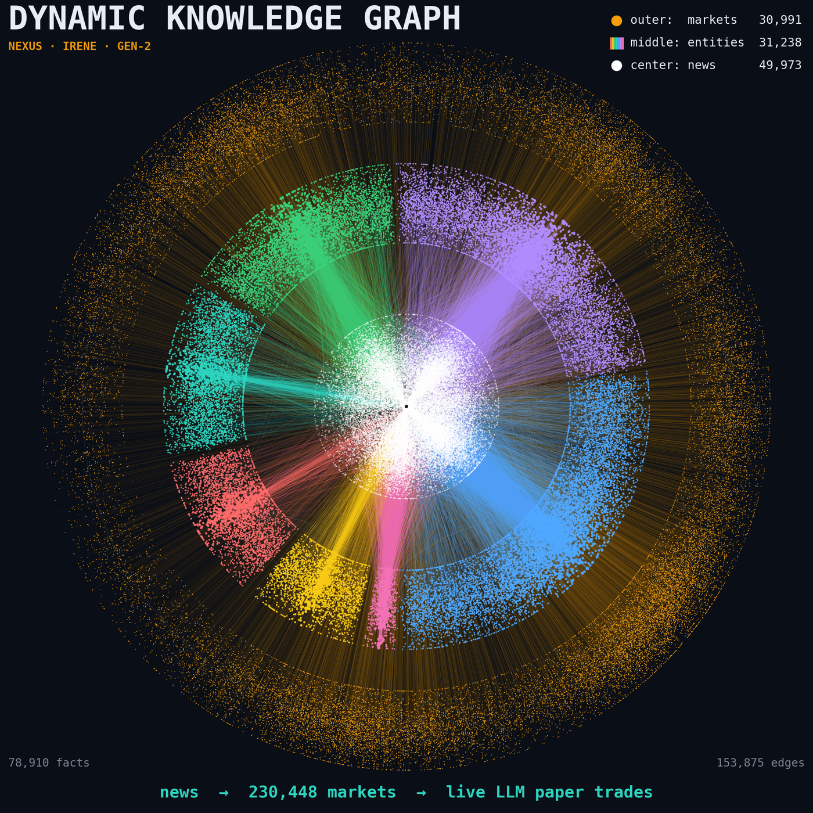
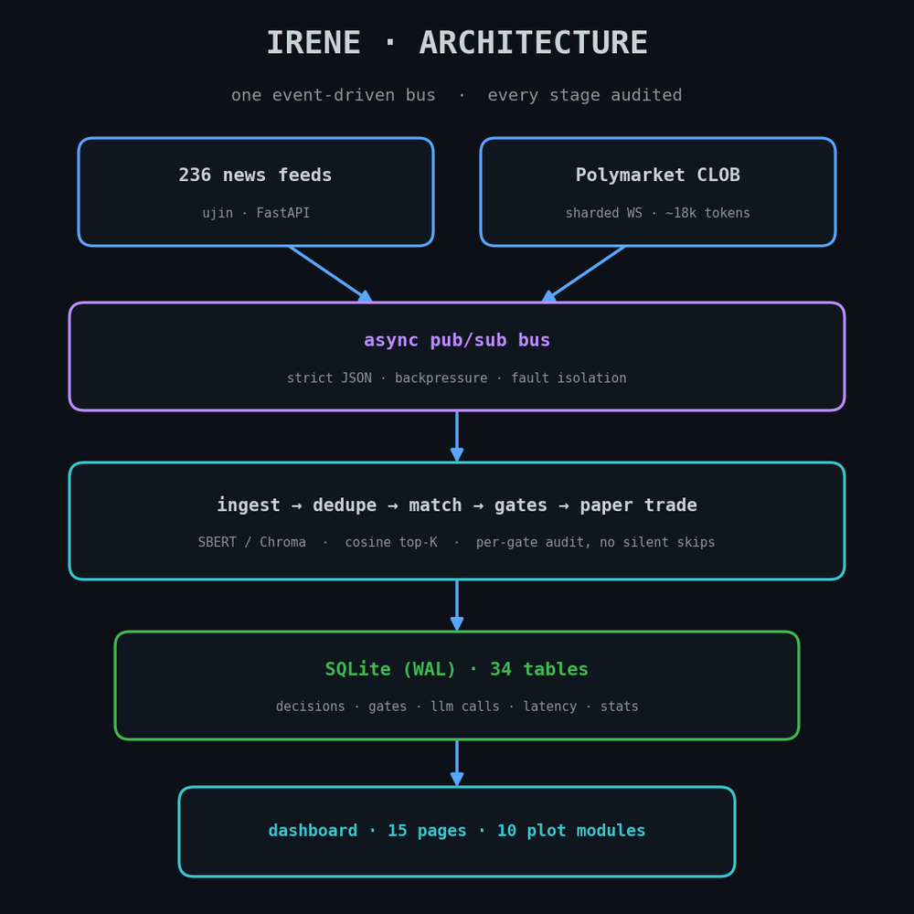
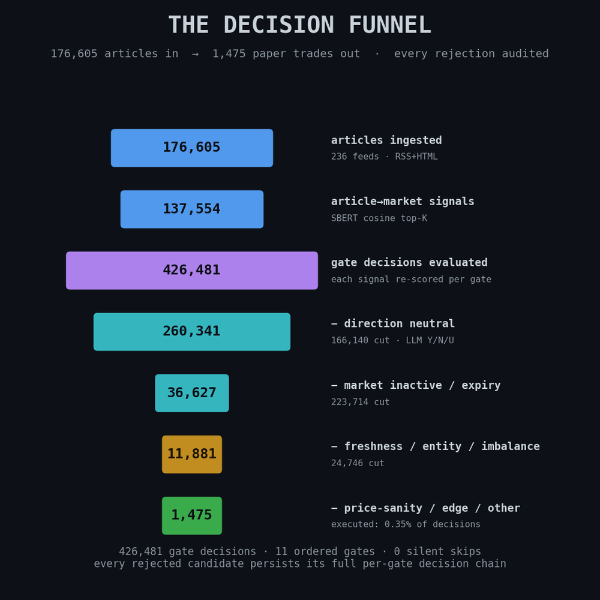
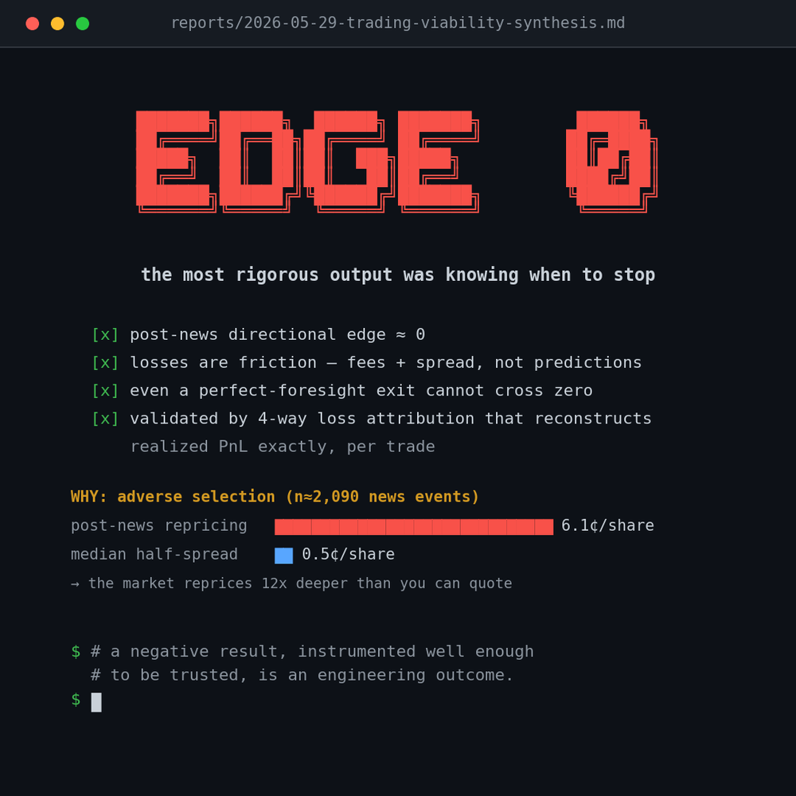
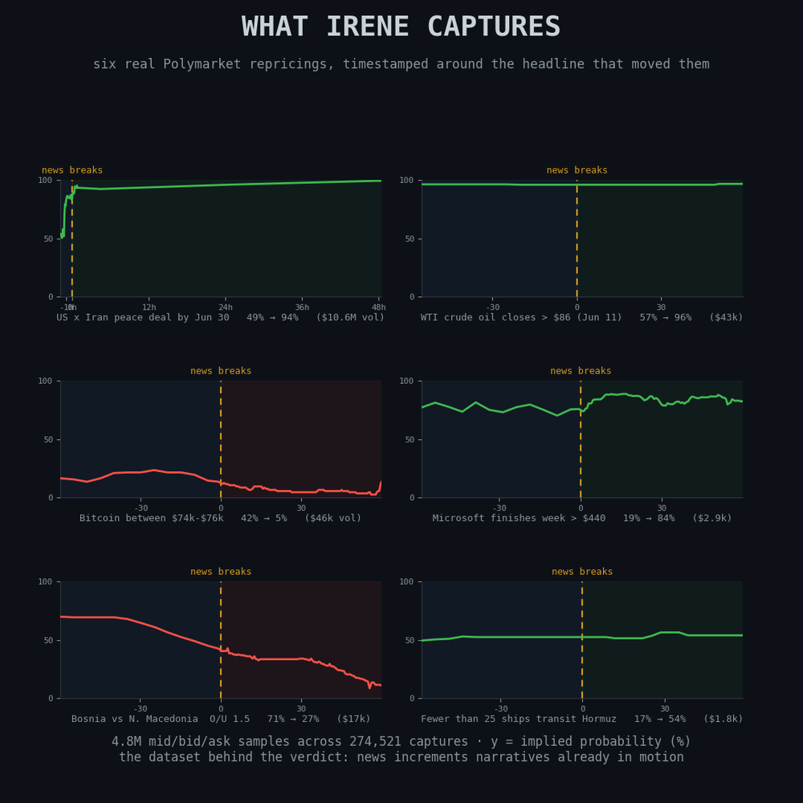
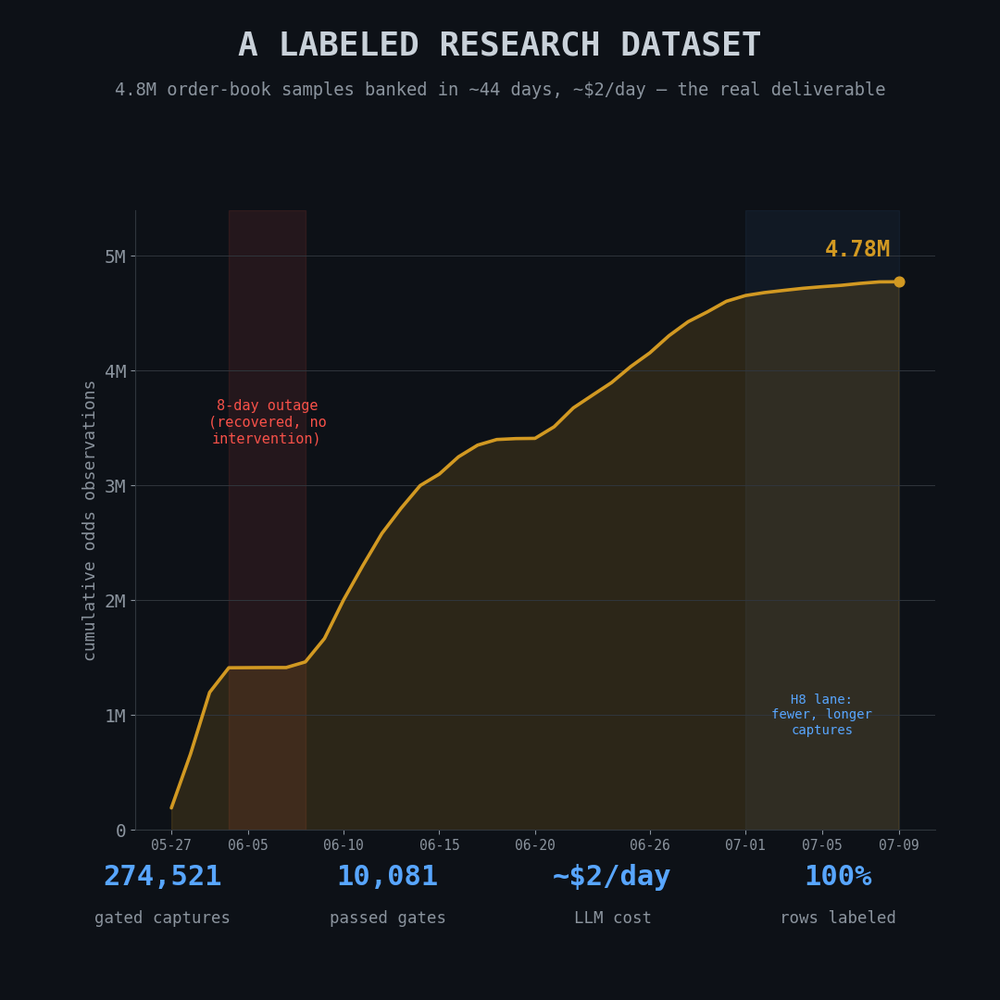
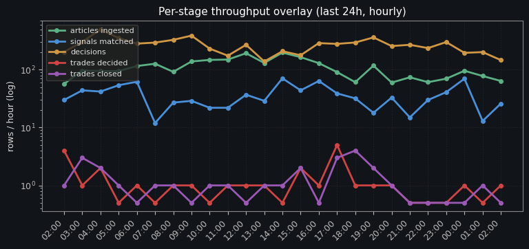
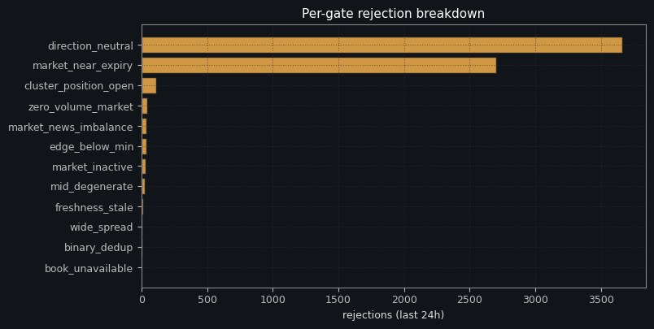
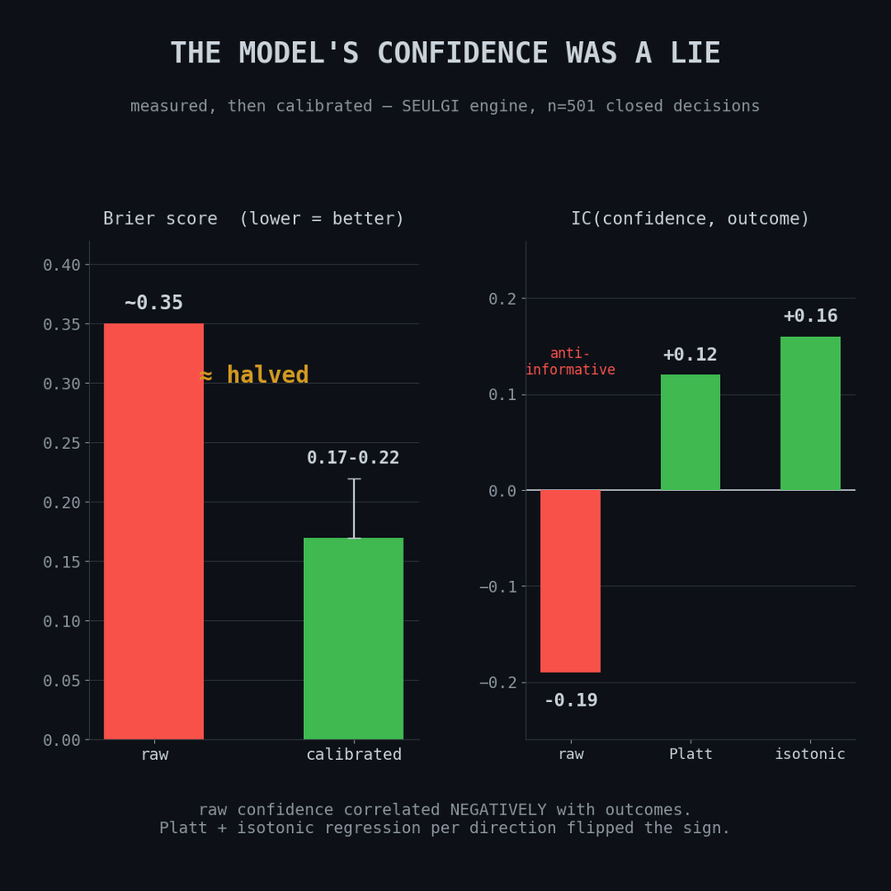

# nexus

Two paper-trading bots for Polymarket, a shared scraping service, and the full
record of what they were built to test and what the data actually said.

The headline result is a negative one. There is no reliable directional edge in
trading prediction markets off breaking news at retail latency. That conclusion
is the product here, and most of this repository exists to show the work behind
it.

The full writeup, with the metric breakdown, the calibration charts, and the
architecture diagram, lives at
[muk.systems/projects/nexus](https://muk.systems/projects/nexus).



That picture is the knowledge graph irene built while looking for the edge.
Every white dot in the middle is a news item, every coloured dot in the ring is
an entity it mentioned, and every orange dot on the outside is a Polymarket
market. 112,202 nodes and 153,875 edges, rendered directly from the live
database by `reports/linkedin-reel/make_dkg_graph.py`.

## The two bots

**seulgi** came first. It reads news, embeds each headline with SBERT, matches
it against an in-memory index of Polymarket markets using cosine similarity,
asks an LLM for a direction, and paper-trades the result through a stack of
filters.

**irene** is a clean-slate rebuild that replaces the cosine matcher with a
dynamic knowledge graph. Instead of asking "is this headline numerically close
to this market question", it extracts entities and events from the article,
resolves them into a graph, and matches on structure. Everything else was
rebuilt too: its own database, its own config, its own dashboard, its own
gates.

They ran side by side on purpose. seulgi is the working baseline the newer
approach had to beat.

## How irene is put together



One async pub/sub bus, strict JSON payloads between stages, and a rule that no
gate may ever skip silently. Every rejected candidate writes a row explaining
which gate stopped it and why. That rule is the reason the analysis further
down was possible at all.

Storage is a single SQLite database in WAL mode, 34 tables, currently about
6.8 GB. The dashboard renders 15 pages from 10 plot modules against that same
database.

## What the funnel looks like



176,605 articles came in. 1,475 paper trades came out, which is about a third
of one percent of the gate decisions evaluated. The single biggest filter is
the LLM being asked one question with three possible answers, yes, no, or
unclear, and answering unclear most of the time.

That one-token answer format was a deliberate cost decision. It cut the LLM
bill by roughly two orders of magnitude, and the savings were spent on
evaluating five times more candidates instead. Total spend on every LLM call
irene has ever made is about 39 dollars.

## What the data said



The thesis was "speed, not prediction". Read decisive news, form a view faster
than the market reprices, take the other side. It was tested in stages and it
failed in stages.

A 54-run backtest sweep found exactly one profitable configuration. On 3.4
times more data that winner turned into a 9.2 percent loss. It had looked good
because six of its nine wins were the same Iran and oil story wearing different
headlines.

Then the losses were decomposed. Roughly 99 percent of the residual loss is
friction, meaning fees and spread, sitting on top of a directional signal of
about zero. An oracle exit, one that knows the future and sells at the best
possible moment, still loses money.

The obvious next thought is to stop paying the spread and quote instead. That
fails differently. Post-news repricing runs about 6.1 cents per share against a
median half-spread of half a cent, so the market moves roughly twelve times
deeper than you can quote. Both sides of the book are closed at retail latency.



This is the clearest picture of why. Six real repricings, each lined up on the
moment the headline broke. Look at how many of them were already moving before
the dashed line. News does not move prediction markets so much as it increments
a narrative that was already in motion, and a model reading headlines is
structurally last in line.

There is one lane that survived. Slow, document-heavy catalysts, where
repricing is delayed because somebody has to actually read a filing or a
ruling. That is the only place where reading beats speed.

## What actually came out of it



The trading thesis failed, but the machine built to test it kept running, and
what it accumulated turned out to be more valuable than the trades. Nearly 4.8
million order-book observations across 274,521 gated captures, every row
labeled with its gate status, the market state at the time, and the model's
verdict and reasoning.

It costs about two dollars a day to run. The eight-day gap in that curve is a
container outage caused by a missing file in a Dockerfile, which it recovered
from without intervention.

## Live operation

The system is still running. These two panels were regenerated from the live
database while writing this README.





## seulgi, and what it taught



seulgi's most useful contribution was a measurement rather than a profit. Its
model reported a confidence number with every prediction, and that number was
worse than useless: it correlated negatively with whether the prediction turned
out to be right. Fitting Platt scaling and isotonic regression per direction
flipped the sign and roughly halved the Brier score.

The lesson generalised. A model's self-reported confidence is a raw output, not
a probability, and it has to be measured against outcomes before anything is
allowed to depend on it.

seulgi also supplied most of irene's hard-won rules. The runtime assertion in
`irene/app/db.py` that refuses to open a database path containing the word
seulgi exists because two containers once wrote to the same chroma directory
and corrupted the index.

## Shared services

`services/ujin` is a submodule pointing at
[Muxite/ujin](https://github.com/Muxite/ujin), which handles fetching,
extraction, RSS, sitemaps, per-host politeness policy, and social sources. Both
bots talk to it over HTTP and neither imports it.

That boundary is why ujin could replace the two earlier in-tree scrapers
without either bot changing more than a hostname. irene uses `POST /scrape` and
`POST /feed`. seulgi uses `POST /scrape`, `POST /social/twitter`, and
`POST /feed`.

## Layout

| Path | What it is |
|---|---|
| `irene/` | The knowledge-graph bot. Start with `irene/architecture.md`. |
| `seulgi/` | The cosine-similarity bot it was built to beat. |
| `services/ujin` | Shared scraping service, as a submodule. |
| `reports/` | Written results, the big retrospective, and the scripts that render every image above. |
| `docs/` | Repo-level notes, including how this was extracted from its original repository. |
| `data/` | Conventions for the runtime data, which is not tracked. |

Each bot keeps its own `architecture.md`, `master-plan.md`, `cycles/`,
`handoffs/`, and `reports/`. Those are the real documentation. This file is
just the map.

The single best document in here is
`reports/2026-06-12-irene-big-retrospective.md`, which goes through every
hypothesis, what the evidence said, and which claims did not survive contact
with more data.

## Running it

```bash
git clone --recurse-submodules https://github.com/Muxite/nexus.git
cd nexus

docker compose up -d ujin                              # shared scraper on :8901
docker compose -f irene/docker-compose.yml  up -d irene
docker compose -f seulgi/docker-compose.yml up -d seulgi
```

Start ujin first, because it creates the `nexus_default` network both bots
attach to. The directory has to be named `nexus` for that network name to come
out right.

Each bot is started from its own compose file and never from the root one. The
root compose deliberately defines only shared services. Running a bot from two
compose files at once is what corrupted that chroma index in May.

ujin pins its own nested submodule over SSH. It is a public repository, but
anonymous clones need this first:

```bash
git config --global url."https://github.com/".insteadOf git@github.com:
```

## Regenerating the images

Everything above is rendered from the live database, not drawn by hand. The
PNGs in `docs/images/` are downscaled copies of the full-resolution output.

```bash
python3 reports/linkedin-reel/make_dkg_graph.py   # the knowledge graph
python3 reports/linkedin-reel/regen_panels.py     # live dashboard panels
python3 reports/linkedin-reel/make_reel.py        # funnel, architecture, findings
```

These need a populated `irene/data/irene.db`, which is not in the repository
because it is large and reproducible.

## Tests

```bash
docker compose -f irene/docker-compose.yml  --profile test run --rm irene-test
docker compose -f seulgi/docker-compose.yml --profile test run --rm seulgi-test
```

irene is at 956 passing. seulgi is at 476 passing with 3 failures that predate
the extraction and reproduce against the original source, two in chromadb
behaviour and one in a debug CLI assertion. 11 tests marked `live` are
deselected because they need running containers.

One irene test, `test_stress_200_count_finishes_fast`, is a known flake. It
runs 200 articles against a hard 30 second budget and fails on a loaded
machine.

### A note on fixture dates

Market `end_date` values in test fixtures are computed relative to now, through
`irene/app/tests/_dates.py`. They are never pinned to a literal.

Four production paths compare `end_date` against the current time, so a fixed
date silently changes meaning as the clock moves. The previous literal was
written in May 2026, sat beyond the 180 day far-future threshold at the time,
drifted inside it in July, and would have crossed into the 6 hour near-expiry
buffer on 2026-12-30, breaking 80 tests on a day nobody would have connected to
a code change. If you add a market fixture, use `open_end_date()` or
`far_future_end_date()`.

`scripts/replay/tests` is included in `testpaths`. It was not, which is how
half of that problem stayed hidden: a plain `pytest` run collected 863 of 956
tests and reported green.

## History

209 commits, all mine, covering both bots from first scaffold through cycle 30.
The tree was extracted from a larger private repository that also held work by
collaborators, none of which is here. `docs/rename-from-jennie.md` records
exactly what moved, what did not, and why.

Runtime data is not tracked. It is derived and it is large, with `irene.db`
alone at about 6.8 GB. See `data/README.md` for the layout and how to rebuild
it.
